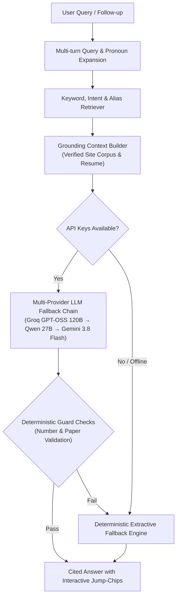

<div align="center">

# ⚡ Balamurugan P G — Portfolio & Grounded AI Assistant

**An engineering-first portfolio featuring verified ML systems, ongoing reinforcement learning research, and an interactive zero-hallucination assistant.**

[](https://nextjs.org/)
[](https://react.dev/)
[](https://www.typescriptlang.org/)
[](https://tailwindcss.com/)
[](https://www.framer.com/motion/)
[](https://pypi.org/project/verascan/)
[](https://playwright.dev/)
[](LICENSE)

[🌐 **Live Website**](https://balamuruganpg.in) · [📄 **Resume (PDF)**](https://balamuruganpg.in/Updated%20Resume/BALAMURUGAN_PG_NIT_CSE.pdf) · [💼 **LinkedIn**](https://www.linkedin.com/in/balamuruganpg) · [🐙 **GitHub**](https://github.com/balamuruganpg) · [🧩 **LeetCode**](https://leetcode.com/u/balamurugan_pg/)

</div>

---

## 🧭 Overview

This repository powers **[balamuruganpg.in](https://balamuruganpg.in)** — built from scratch to showcase machine learning systems with concrete, reproducible receipts instead of inflated claims. 

It catalogues **17 projects** (including ongoing sim-to-real RL research, published PyPI packages, research prototypes, and live computer vision apps) alongside an **in-browser AI assistant** strictly grounded to verified site facts.

---

## ✨ Key Features

### 🤖 Grounded AI Assistant Architecture
An integrated assistant designed with zero-tolerance hallucination boundaries:
- **Dual-Mode Retrieval**: Fast keyword, alias, and intent-weighted scoring over verified site corpus (`src/data/site.ts`) and resume markdown (`content/resume.md`).
- **Multi-Provider Fallback Chain**: Orchestrates queries across **Groq** (`openai/gpt-oss-120b`, `openai/gpt-oss-20b`, `qwen/qwen3.8-27b`) and **Google Gemini** (`gemini-3.8-flash`), with automatic token failover.
- **Source Checks**: Generated paragraphs require exact source IDs and pass checks for citation coverage, supported numbers, URLs and protected claims. Failed drafts get one bounded rewrite, then a clear retry state with source links. Raw repository excerpts are not substituted as the assistant's answer.
- **Interactive Citation Chips**: Every assistant answer generates clickable citation tags (`[VeraScan ↗]`, `[RAI-Axiom ↗]`) that smoothly scroll to and trigger visual spotlights on the matching card.
- **Pronoun & Multi-Turn Context**: Resolves follow-up queries (*"What stack does it use?"*, *"Is there a live demo?"*) using conversation history.



---

### 🎨 UI & UX Craftsmanship
- **Dynamic Spotlight Grids**: Hardware-accelerated radial spotlight gradients follow the cursor across case cards.
- **System-Aware Theme Engine**: Automatically detects system dark/light preferences on first visit with instant, flicker-free manual toggling.
- **Command Palette (`Ctrl + K`)**: Keyboard-driven navigation across projects, filter categories, live links, and contact channels.
- **Responsive Layout**: Designed for seamless fluid viewing across mobile phones, tablets, and wide-gamut desktop monitors.

---

## 🔬 Featured Projects & Research

| Project | Category | Key Method & Architecture | Verified Empirical Metric | Links |
| :--- | :--- | :--- | :--- | :--- |
| **RAI-Axiom** *(Ongoing)* | Deep Learning / RL | PPO portfolio-allocation policy trained purely on synthetic markets (zero real prices during training); evaluated zero-shot across 6 real universes. By Balamurugan P G & Jason Pandian. | **Tested tie with SPY** (out of sample · 10-seed CI) | [Repo](https://github.com/axiom-sim2real/RAI-Axiom) |
| **VeraScan** | Evaluation / MLOps | 4-tier train/eval benchmark data contamination detection (exact match, 13-gram overlap, fuzzy Levenshtein, semantic embeddings). | **Published on PyPI** (`pip install verascan`) | [Repo](https://github.com/balamuruganpg/verascan) · [PyPI](https://pypi.org/project/verascan/) |
| **CertiRoute** *(Prototype)* | LLM Routing / Reliability | OpenAI-compatible gateway scoring prompts with a local logistic classifier and routing via conformal risk control. No embeddings or extra model call. | **32.77% offline savings (4.769% regret)** · Live Groq+xAI: 15.96% savings, 12.12% regret (missed 5% target) | [Repo](https://github.com/balamuruganpg/CertiRoute) |
| **Bull/Bear Autopilot** | Multi-Agent LLMs | Opposing bull/bear financial analyst agents synthesizing Indian IPO filings with page citations and deterministic fact-checking. | **568 automated unit & integration tests** | [Repo](https://github.com/balamuruganpg/bull-bear-autopilot) |
| **LungScan AI** | Computer Vision | 5-class chest pathology diagnosis using fine-tuned DenseNet121 with Grad-CAM visual heatmaps. FastAPI + React + Supabase on GCP. | **86–88% Test Accuracy** | [Repo](https://github.com/balamuruganpg/LungScan-AI-Chest-Xray-Detection) · [Live App](https://medrag.in) |
| **PneumoScan** | Computer Vision | MobileNetV2 convolutional neural network for automated pediatric pneumonia detection from radiographic scans. | **92.5% Test Accuracy** | [Repo](https://github.com/balamuruganpg/Pneumonia-Xray-CNN-Detection) · [Live App](https://pneumonia-scan.streamlit.app/) |
| **AI LeetCode Agent** | Autonomous Agents | Resilient problem solver coordinating 5-provider LLM failover with 4 Playwright browser workers. | **230+ Accepted Submissions** | [Repo](https://github.com/balamuruganpg/ai-leetcode-agent) |

<details>
<summary><b>📂 View Complete Catalog of All 17 Repositories</b></summary>

| Project Name | Category | Primary Stack | Key Highlights |
| :--- | :--- | :--- | :--- |
| **Signal** | Course | Streamlit, Python, GCP Monitoring | Cloud SLA monitor for U23CS702 with seeded simulation and 4 SLA metrics across light and dark themes. |
| **ChurnGuard Pro** | Dashboards | Gradient Boosting, Streamlit | Customer retention analytics trained on 7,043 customer records. |
| **OncoInsight Pro** | Dashboards | GBR/GBC, Statistics, Streamlit | Cancer telemetry and risk stratification dashboard over 17,686 records. |
| **Household Power RNN** | Deep Learning | Recurrent Neural Network | Time-series electrical telemetry sequence prediction. |
| **Titanic ANN** | Deep Learning | Artificial Neural Network | Feedforward multi-layer perceptron for tabular survival prediction. |
| **K-Means Clustering** | Clustering | Scikit-learn, NumPy | Unsupervised demographic spatial clustering on physical distributions. |
| **DBSCAN Clustering** | Clustering | Density-Based Spatial Clustering | Noise-tolerant geometric cluster identification. |
| **Hierarchical Clustering** | Clustering | Agglomerative Clustering | Dendrogram tree clustering over anthropometric observations. |
| **Video Game Sales EDA** | EDA | Pandas, Seaborn, Matplotlib | Multi-decade global video game sales distribution profiling. |
| **Luxury Car Dealership** | Web | JavaScript, HTML/CSS | Automotive inventory showcase and responsive sales UI. |

</details>

---

## 🛠️ Tech Stack & Tooling

```
Frontend:          Next.js 15 (App Router), React 19, TypeScript
Styling:           Tailwind CSS v4, CSS Variables, Hardware-accelerated motion
Animations:        Framer Motion 14, Canvas & Radial Spotlight Shaders
LLM Orchestration: Groq Cloud API, Google Gemini API, Custom Fallback Router
Testing:           Playwright Core (End-to-End Real Browser Automation)
Package Authoring: setuptools, PyPI, twine (VeraScan)
Deployment:        Vercel / Node.js
```

---

## 🚀 Getting Started

### Prerequisites
- **Node.js**: `v20.x` or higher
- **npm**: `v10.x` or higher

### 1. Clone the repository
```bash
git clone https://github.com/balamuruganpg/portfolio.git
cd portfolio
```

### 2. Install dependencies
```bash
npm install
```

### 3. Configure Environment Variables (Optional)
The portfolio and its evidence links work without a model key. Conversational answers use retrieval followed by model generation; if the model is unavailable, the assistant shows a retry state and source links. To enable the multi-model LLM chat assistant, create a `.env.local` file:

```bash
cp .env.example .env.local
```

Add your API keys:
```env
# Google Gemini API Key (optional)
GEMINI_API_KEY=your_gemini_api_key

# Groq is the preferred provider (optional)
GROQ_API_KEY=your_groq_api_key
# Optional second server-side key:
GROQ_API_KEY_2=your_second_groq_api_key
GROQ_MODEL=openai/gpt-oss-120b

# Optional model override (defaults to gemini-3.8-flash)
GEMINI_MODEL=gemini-3.8-flash
```

Keys stay in `.env.local` (ignored by Git), or in your hosting environment. Do not use `NEXT_PUBLIC_` variables. Restart the server after changing keys. There is no public key-entry or key-saving endpoint.

The assistant prefers Groq: the configured model tries `GROQ_API_KEY`, then optional `GROQ_API_KEY_2`, followed by `openai/gpt-oss-20b` with the same key order. Healthy primary requests do not use the second key. Blank/duplicate keys are ignored; authentication failures skip only the rejected key for that request. Each provider pass retains its 12-second total budget (two-key Groq attempts have a 3-second individual timeout); generation and at most one source-validation rewrite share a 16-second deadline. Existing Gemini and OpenRouter configurations remain optional fallbacks. If generation is unavailable or fails source validation, it displays a clear retry state with the retrieved source links. Each generated RAG reply displays the provider and model actually used, never the key.

Two keys in the same Groq organization share its quota; adding a key does not increase organization limits. See [Groq rate limits](https://console.groq.com/docs/rate-limits). Enter the second key directly in `.env.local` or your hosting environment, never in a public form or chat.

Requests for more detail retrieve diverse implementation sections, carrying the project forward from conversation history and preferring sections not already cited. Groq returns structured paragraphs with explicit source IDs; the server validates the claims and IDs before rendering citations. Run `npm run test:details` against a running server with a valid Groq configuration to reproduce the two-turn VeraScan detail regression using the live API.

“How does it work?” retrieves a workflow with implementation/output sections; “I didn't understand” rephrases the active subject in everyday language. The visitor's most recent explicit subject can recover from an older mistaken assistant citation. A context-free clarification asks which subject the visitor means. Limitations are retrieved/discussed only on request; quoted benchmark claims retain their essential qualifications. Default follow-up prompts emphasize understanding and trying the work. Questions about the assistant's provider use current server configuration instead of searching project descriptions.

`node scripts/assistant-understanding-e2e.mjs` reproduces the exact three-turn VeraScan complaint against a running Groq-backed server, plus explicit limitations, identity and clarification checks.

### 4. Run the Development Server
```bash
npm run dev
```
Open **[http://localhost:3000](http://localhost:3000)** in your browser.

---

## 🧪 Testing & Verification

The repository includes a thorough automated Playwright test suite (`scripts/e2e.mjs`) verifying:
1. Complete filter tab isolation (`All: 15`, `Agents: 2`, `Deep Learning: 5`, etc.).
2. External HTTP 200 health checks for all live apps, PyPI packages, and GitHub repositories.
3. Assistant grounding against hallucination attacks, off-topic prompts, and citation spotlight jumping.
4. Local PDF resume asset delivery (`/Updated%20Resume/BALAMURUGAN_PG_NIT_CSE.pdf`).

To run the verification suite:
```bash
# 1. Build and start production instance
npm run build
npm start

# 2. In a second terminal, execute the test runner:
npm run test:e2e

# No network or key required for deterministic agent and guard checks:
npm run test:assistant
npm run test:guards

# With the local server running (requires installed Edge):
node scripts/header-agent-e2e.mjs
```

```
PASS  page loads — Balamurugan P G: AI/ML Engineer
PASS  every external link has target=_blank + noopener
PASS  resume download serves local PDF — 3 buttons, status 200
PASS  filter "All" shows 15 — got 15
PASS  filter "Deep Learning" shows 5 — got 5
PASS  click repo RAI-Axiom — 200 https://github.com/axiom-sim2real/RAI-Axiom
PASS  click live LungScan (medrag.in) — 200 https://medrag.in/
PASS  click PyPI verascan — 200 https://pypi.org/project/verascan/
PASS  Ctrl+K jumps to PneumoScan
PASS  assistant labelled "Grounded on this site, not the open web."
PASS  RAI-Axiom answer cites RAI-Axiom
PASS  RAI-Axiom mentions Balamurugan & Jason Pandian
PASS  RAI-Axiom does not claim to beat buy-and-hold
PASS  citation chip jumps to RAI-Axiom card
PASS  no console errors
40/40 passed
```

---

## 📁 Repository Structure

```
├── content/
│   └── resume.md               # Structured markdown resume indexed by retriever
├── public/
│   ├── BalamuruganPG_Resume.pdf# Verified local resume PDF
│   └── icon.svg                # Minimal portfolio monogram favicon
├── scripts/
│   ├── e2e.mjs                 # 40-assertion Playwright test suite
│   └── guard-test.mts          # Standalone hallucination guard tests
├── src/
│   ├── app/
│   │   ├── api/chat/           # Multi-provider LLM fallback & guard route
│   │   ├── api/save-key/       # Client session key configuration
│   │   ├── layout.tsx          # Root metadata, themes & fonts
│   │   └── page.tsx            # Main portfolio layout & case study sections
│   ├── components/
│   │   ├── Assistant.tsx       # Grounded conversational AI assistant UI
│   │   ├── CommandPalette.tsx  # Ctrl+K modal launcher
│   │   ├── Hero.tsx            # Hero presentation with animated badges
│   │   ├── Projects.tsx        # Filterable 15-repo card grid
│   │   ├── SkillsSection.tsx   # Verified skill receipts & metrics
│   │   ├── ThemeToggle.tsx     # Dark/light mode switcher
│   │   └── ui.tsx              # Reusable buttons, chips, and motion primitives
│   ├── data/
│   │   └── site.ts             # Single source of truth for projects, skills & profile
│   └── lib/
│       ├── corpus.ts           # Document indexing & section tokenization
│       └── retrieve.ts         # Keyword ranking, intents & hallucination regex
└── README.md
```

---

## 👤 Author

**Balamurugan P G**
- 🎓 B.E. Computer Science and Engineering, Nehru Institute of Technology (Anna University)
- 📍 Coimbatore, Tamil Nadu, India
- ✉️ [balamuruganpg@outlook.com](mailto:balamuruganpg@outlook.com)
- 🌐 [https://balamuruganpg.in](https://balamuruganpg.in)
- 🐙 GitHub: [@balamuruganpg](https://github.com/balamuruganpg)
- 💼 LinkedIn: [in/balamuruganpg](https://www.linkedin.com/in/balamuruganpg)
- 🧩 LeetCode: [u/balamurugan_pg](https://leetcode.com/u/balamurugan_pg/)

---

## 📄 License

This project is open-source and available under the [MIT License](LICENSE).

## Separate RAG knowledge base

The assistant retrieves from approved site facts plus a server-only source index in `content/rag/`. The snapshot includes all 17 listed repositories at immutable commits, selected architecture/evaluation docs, resume passages, GitHub profile metadata and VeraScan package documentation. Exact project names and certificate categories use direct routing. Open-ended questions use a bounded model query planner that selects only known source IDs and technical search terms, followed by heading-weighted BM25 passage retrieval. Comparisons reserve evidence for each selected project. This is model-assisted retrieval, without embeddings or a vector database. Imported sources never automatically change public page claims.

```bash
npm run rag:sync       # refresh allowlisted source snapshots (owner-run, network)
npm run rag:rebuild    # rebuild saved snapshots (no network)
npm run rag:verify     # check hashes, reproducibility and repository coverage
npm run test:rag       # deterministic retrieval/source-policy tests
npm run test:guardrails:e2e  # adversarial API checks against a running server
```

Chat requests never crawl visitor-supplied URLs. GitHub citations point to original file lines at a saved commit. Unmatched metrics and suspicious source sections are excluded; keys stay server-side and credential-shaped strings are redacted before snapshots are stored.

### Certificate proof

`src/data/credentials.ts` contains the document-backed credential catalogue. The owner-provided `Certificates/` folder is preserved; byte-identical public proof files are under `public/credentials/`. There are 45 unique completed credentials from 47 certificate documents (two duplicate PDF pairs), with 12 highlighted entries. The separate TXT file supplies the Masai verification link. Course and programme completion records are distinguished from Oracle certifications; IBM programme component courses retain their relationship to the parent programme.

Deep Learning Specialization by Andrew Ng is owner-confirmed **in progress**, excluded from the completed count. AI For Everyone is a separate completed course. No Tableau certificate was supplied, so Tableau remains a skill rather than a claimed certificate.

The assistant retrieves individual credential records with exact IDs and proof citations. Public educational credentials are distinguished from private authentication credentials. All 41 supplied/embedded verification URLs returned successful HTTP responses during the 2026-11-01 check; the four Oracle documents provide printed IDs and original PDFs instead. Link availability is not independent issuer attestation.

```powershell
npm run test:credentials      # Counts, deduplication, source/public SHA-256, IDs and URL destinations
npm run test:credentials:e2e  # Running server: responsive cards, catalogue search and all proof files
npm run test:credentials:api  # Running server + model: specific proof, study status and private-secret refusal
node scripts/query-planner-test.mjs # Structured routing, cancellation and lexical fallback
node scripts/certificate-navigation-e2e.mjs # Header, tabs, search, issuer filters and catalogue actions
node scripts/assistant-conversation-e2e.mjs # Running server + model: broad questions and follow-ups
```

To update the catalogue, inspect the original document and its embedded links, retain its SHA-256 and source paths, add one canonical record per unique credential, and copy its original bytes to its public proof path. Never manufacture a verification URL or treat an in-progress course as completed. Featured/All tabs, global search and issuer filters are above the cards; matching cards mount in pages of twelve and proof assets load only when opened. The header, command palette and assistant catalogue buttons provide direct navigation.

LinkedIn blocks public retrieval for the exact profile (HTTP 999). The assistant discloses that gap. The owner can supply profile text using the format in `content/rag/imports/README.md`.
